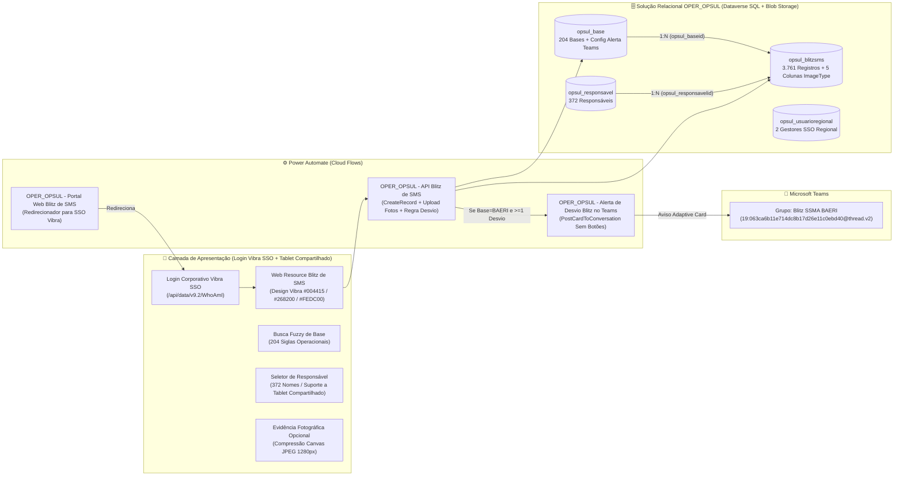

# 🛡️ Solução Relacional `OPER_OPSUL` — Blitz de SMS & Portal Web (Login Corporativo Vibra SSO + Alerta Teams BAERI)

> **Repositório Oficial Versionado (`v1.4.0`)** — Banco de Dados Relacional `OPER_OPSUL` no Microsoft Dataverse (4 tabelas relacionais, **3.761 registros históricos** migrados, **204 bases operacionais**, **372 responsáveis** e tabela de **Usuários do Regional para SSO**) + Aplicativo Web com **Login Corporativo Obrigatório Vibra Energia (Microsoft Entra ID / Dataverse SSO)**, Design System Vibra Energia, Busca Fuzzy, Evidência Fotográfica Nativa e **Alerta Automático de Desvios no Microsoft Teams para a unidade `BAERI` (grupo `Blitz SSMA BAERI`)**.

- **Ambiente Power Platform (Solução & Dados):** `Cristian Ferreira Carlos` (`4a9ba077-4920-ea16-ae45-293f56eb85e3` — `https://orgd15f46d4.crm2.dynamics.com`)
- **Ambiente Power Platform (Relay Microsoft Teams):** `autoBR@x - Desenvolvimento` (`898c553e-12ff-e6c6-8b11-bc7586165a03` — `https://org165415fc.crm.dynamics.com`)
- **Solução Dataverse:** `OPER_OPSUL` (`e11a7dcc-45d9-f111-84e8-e4fade0322c2`)
- **Publisher:** `OPER_OPSUL Vibra Energia` (prefixo `opsul_`)
- **Grupo Microsoft Teams (`BAERI`):** **`Blitz SSMA BAERI`** (`19:063ca6b11e714dc8b17d26e11c0ebd40@thread.v2`)
- **Link Oficial do App (Exige Login Corporativo Vibra SSO):** [Abrir Aplicativo Blitz de SMS — OPER_OPSUL (SSO Vibra)](https://orgd15f46d4.crm2.dynamics.com/WebResources/opsul_blitz_sms_app.html)
- **Link de Redirecionamento Automático (`Portal Flow -> SSO Vibra`):** [Redirecionador Portal OPER_OPSUL](https://4a9ba0774920ea16ae45293f56eb85.e3.environment.api.powerplatform.com:443/powerautomate/automations/direct/cu/28/workflows/22bf8a38645945cea776aadeb945e1e9/triggers/manual/paths/invoke?api-version=1&sp=%2Ftriggers%2Fmanual%2Frun&sv=1.0&sig=lX9gzbxvImHj0A29PSf5YqK96YoU56w9VuQSGBCsEQo)

---

## 1. Arquitetura da Solução `OPER_OPSUL` (`v1.4.0`)



> **Operação em Tablets Compartilhados nas Bases:** O aplicativo exige que o dispositivo esteja autenticado no ambiente corporativo da Vibra Energia (`@vibraenergia.com.br` via SSO no Dataverse), registrando a conta autenticada do aparelho em `opsul_responsavel_email`, enquanto mantém o seletor **Responsável pela Blitz** aberto (`opsul_responsavel_nome`) para que múltiplos inspetores/operadores que compartilham o mesmo tablet em campo selecionem seu próprio nome a cada Blitz.
>
> **Alerta Automático de Desvios no Teams (`BAERI`):** Sempre que uma Blitz na **`BAERI`** (`opsul_alerta_teams_ativo = true`) registrar **1 ou mais desvios** no checklist (Itens 01 a 05), um card informativo (**sem botões de ação**) é publicado automaticamente no grupo **`Blitz SSMA BAERI`** do Microsoft Teams.

---

## 2. Inventário de Tabelas Relacionais na Solução `OPER_OPSUL` (4)

| Tabela (`LogicalName`) | `EntitySetName` | Registros | Papel na Arquitetura | Schema & Dados |
| :--- | :--- | :---: | :--- | :--- |
| **`opsul_blitzsms`** | `opsul_blitzsmses` | **3.761** | Tabela fato principal de inspeções Blitz de SMS (25 atributos + 5 colunas `ImageType` 10 MB para fotos de NC + 2 lookups 1:N) | [`schema/oper_opsul_entities_metadata.json`](./schema/oper_opsul_entities_metadata.json) |
| **`opsul_base`** | `opsul_bases` | **204** | Dimensão de Bases Operacionais (`BA`, `RA`, `AR`, `AI`, `DE`, `BE`, `SEDE`, `GEI`, `CCPP`, `EPS`) + parametrização de alertas no Teams (`opsul_alerta_teams_ativo`, `opsul_destinatarios_teams` — ativa em `BAERI`) | [`schema/bases_catalogo_204.json`](./schema/bases_catalogo_204.json) |
| **`opsul_responsavel`** | `opsul_responsavels` | **372** | Dimensão de Responsáveis pela Blitz (*escreve o nome 1x e depois escolhe na lista*, ideal para tablets compartilhados) | [`schema/oper_opsul_entities_metadata.json`](./schema/oper_opsul_entities_metadata.json) |
| **`opsul_usuarioregional`** | `opsul_usuarioregionals` | **2** | Usuários do Regional OPSUL (`wedson@vibraenergia.com.br` e `anasales@vibraenergia.com.br`) preparados para login SSO em solução futura | [`schema/usuarios_regionais_sso.json`](./schema/usuarios_regionais_sso.json) |

---

## 3. Inventário de Fluxos e Recursos Web Ativos (4)

| Componente | Tipo | ID no Dataverse | Autenticação / Canal | Código-Fonte |
| :--- | :--- | :--- | :---: | :--- |
| **`opsul_blitz_sms_app.html`** | Dataverse Web Resource (HTML) | `246bf32a-48d9-f111-84e8-e4fade0322c2` | **SSO Microsoft Entra ID Vibra** (`/api/data/v9.2/WhoAmI`) | [`webresources/opsul_blitz_sms_app.html`](./webresources/opsul_blitz_sms_app.html) |
| **OPER_OPSUL - Portal Web Blitz de SMS** | Solution Cloud Flow | `8bfaac34-48d9-f111-84e8-e4fade0322c2` | Redirecionador automático para o Web Resource SSO | [`flows/oper_opsul_portal_web_blitz_de_sms/`](./flows/oper_opsul_portal_web_blitz_de_sms/README.md) |
| **OPER_OPSUL - API Blitz de SMS** | Solution Cloud Flow | `592191f7-47d9-f111-84e8-e4fade0322c2` | Endpoint POST (`CreateRecord` + Fotos + Disparo Alerta Teams) | [`flows/oper_opsul_api_blitz_de_sms/`](./flows/oper_opsul_api_blitz_de_sms/README.md) |
| **OPER_OPSUL - Alerta de Desvio Blitz de SMS no Teams (BAERI)** | Cloud Flow (`898c553e`) | `d5c4bed7-10da-f111-84e8-000d3a8cdf8c` | `shared_teams` -> Grupo **`Blitz SSMA BAERI`** (`19:063ca6b11e714dc8b17d26e11c0ebd40@thread.v2`) | [`flows/oper_opsul_alerta_desvio_blitz_teams_baeri/`](./flows/oper_opsul_alerta_desvio_blitz_teams_baeri/README.md) |

---

## 4. Estrutura do Repositório

```text
vibra-oper-opsul-blitz-sms/
├── README.md                                     # Visão geral executiva e inventário da solução OPER_OPSUL
├── CHANGELOG.md                                  # Histórico de releases
├── docs/
│   └── ARQUITETURA_E_MODELO_RELACIONAL.md        # DER completo, especificações das 4 tabelas e Design System Vibra
├── schema/
│   ├── oper_opsul_entities_metadata.json         # Manifesto do modelo relacional no Dataverse
│   ├── bases_catalogo_204.json                   # Catálogo completo das 204 Bases Operacionais
│   └── usuarios_regionais_sso.json               # Usuários do Regional OPSUL (SSO futuro)
├── webresources/
│   └── opsul_blitz_sms_app.html                  # Aplicação Single-Page Blitz de SMS (SSO Vibra + Busca Fuzzy + Design Vibra)
├── flows/
│   ├── oper_opsul_portal_web_blitz_de_sms/       # Flow HTTP GET que redireciona para o Web Resource SSO
│   ├── oper_opsul_api_blitz_de_sms/              # Flow HTTP POST que grava a Blitz, fotos e aciona o alerta de desvios
│   └── oper_opsul_alerta_desvio_blitz_teams_baeri/ # Flow que envia o card informativo ao grupo Blitz SSMA BAERI no Teams
└── scripts/
    ├── create_oper_opsul_schema.py               # Provisiona Publisher, Solução OPER_OPSUL e as 4 tabelas relacionais
    ├── seed_and_migrate_oper_opsul.py            # Popula dimensões e migra os 3.761 registros do SharePoint
    ├── build_app_html.py                         # Gera o pacote HTML5 com catálogos embutidos e Design System Vibra
    ├── deploy_portal_and_webresource.py          # Publica WebResource e ativa os fluxos no Power Platform
    └── export_from_powerplatform.py              # Sincroniza definições a partir do ambiente Dataverse
```
