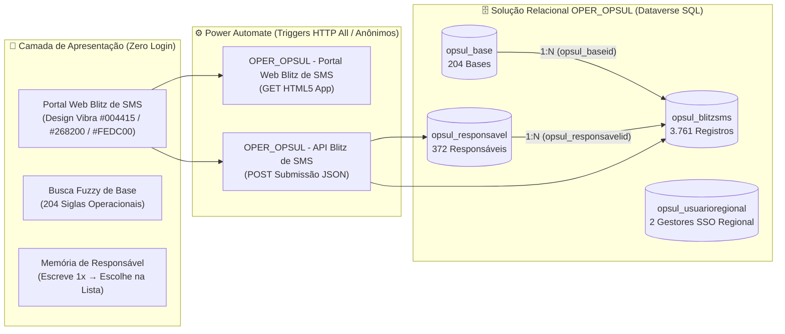

# 🛡️ Solução Relacional `OPER_OPSUL` — Blitz de SMS & Portal Web (Sem Login)

> **Repositório Oficial Versionado (`v1.0.0`)** — Banco de Dados Relacional `OPER_OPSUL` no Microsoft Dataverse (4 tabelas relacionais, **3.761 registros históricos** migrados, **204 bases operacionais**, **372 responsáveis** e tabela de **Usuários do Regional para SSO**) + Portal/Formulário Web Anônimo (Sem Login) com Design System Vibra Energia e Busca Fuzzy.

- **Ambiente Power Platform:** `Cristian Ferreira Carlos` (`4a9ba077-4920-ea16-ae45-293f56eb85e3`)
- **Dataverse URL:** `https://orgd15f46d4.crm2.dynamics.com`
- **Solução Dataverse:** `OPER_OPSUL` (`e11a7dcc-45d9-f111-84e8-e4fade0322c2`)
- **Publisher:** `OPER_OPSUL Vibra Energia` (prefixo `opsul_`)
- **Link Público do App (Sem Login):** [Abrir Portal Blitz de SMS — OPER_OPSUL](https://4a9ba0774920ea16ae45293f56eb85.e3.environment.api.powerplatform.com:443/powerautomate/automations/direct/cu/28/workflows/22bf8a38645945cea776aadeb945e1e9/triggers/manual/paths/invoke?api-version=1&sp=%2Ftriggers%2Fmanual%2Frun&sv=1.0&sig=lX9gzbxvImHj0A29PSf5YqK96YoU56w9VuQSGBCsEQo)

---

## 1. Arquitetura da Solução `OPER_OPSUL`



---

## 2. Inventário de Tabelas Relacionais na Solução `OPER_OPSUL` (4)

| Tabela (`LogicalName`) | `EntitySetName` | Registros | Papel na Arquitetura | Schema & Dados |
| :--- | :--- | :---: | :--- | :--- |
| **`opsul_blitzsms`** | `opsul_blitzsmses` | **3.761** | Tabela fato principal de inspeções Blitz de SMS (26 atributos + 2 lookups 1:N) | [`schema/oper_opsul_entities_metadata.json`](./schema/oper_opsul_entities_metadata.json) |
| **`opsul_base`** | `opsul_bases` | **204** | Dimensão de Bases Operacionais (`BA`, `RA`, `AR`, `AI`, `DE`, `BE`, `SEDE`, `GEI`, `CCPP`, `EPS`) | [`schema/bases_catalogo_204.json`](./schema/bases_catalogo_204.json) |
| **`opsul_responsavel`** | `opsul_responsavels` | **372** | Dimensão de Responsáveis pela Blitz (*escreve o nome 1x e depois escolhe na lista*) | [`schema/oper_opsul_entities_metadata.json`](./schema/oper_opsul_entities_metadata.json) |
| **`opsul_usuarioregional`** | `opsul_usuarioregionals` | **2** | Usuários do Regional OPSUL (`wedson@vibraenergia.com.br` e `anasales@vibraenergia.com.br`) preparados para login SSO em solução futura | [`schema/usuarios_regionais_sso.json`](./schema/usuarios_regionais_sso.json) |

---

## 3. Inventário de Fluxos e Recursos Web Ativos (3)

| Componente | Tipo | ID no Dataverse | Autenticação | Código-Fonte |
| :--- | :--- | :--- | :---: | :--- |
| **OPER_OPSUL - Portal Web Blitz de SMS (Sem Login)** | Solution Cloud Flow | `8bfaac34-48d9-f111-84e8-e4fade0322c2` | `All` (Anônimo / Zero Login) | [`flows/oper_opsul_portal_web_blitz_de_sms/`](./flows/oper_opsul_portal_web_blitz_de_sms/README.md) |
| **OPER_OPSUL - API Blitz de SMS (Sem Login)** | Solution Cloud Flow | `592191f7-47d9-f111-84e8-e4fade0322c2` | `All` (Anônimo / Zero Login) | [`flows/oper_opsul_api_blitz_de_sms/`](./flows/oper_opsul_api_blitz_de_sms/README.md) |
| **`opsul_blitz_sms_app.html`** | Dataverse Web Resource (HTML) | `246bf32a-48d9-f111-84e8-e4fade0322c2` | Web Resource / Power Pages | [`webresources/opsul_blitz_sms_app.html`](./webresources/opsul_blitz_sms_app.html) |

---

## 4. Estrutura do Repositório

```text
vibra-oper-opsul-blitz-sms/
├── README.md                                     # Visão geral executiva e inventário da solução OPER_OPSUL
├── CHANGELOG.md                                  # Histórico de releases
├── docs/
│   └── ARQUITETURA_E_MODELO_RELACIONAL.md        # DER completo, especificações das 4 tabelas e Design System Vibra
├── schema/
│   ├── oper_opsul_entities_metadata.json         # Manifesto do modelo relacional no Dataverse
│   ├── bases_catalogo_204.json                   # Catálogo completo das 204 Bases Operacionais
│   └── usuarios_regionais_sso.json               # Usuários do Regional OPSUL (SSO futuro)
├── webresources/
│   └── opsul_blitz_sms_app.html                  # Aplicação Single-Page Blitz de SMS (Busca Fuzzy + Design Vibra)
├── flows/
│   ├── oper_opsul_portal_web_blitz_de_sms/       # Flow HTTP GET que serve o Portal Web sem exigir login
│   └── oper_opsul_api_blitz_de_sms/              # Flow HTTP POST que processa os envios da Blitz de SMS
└── scripts/
    ├── create_oper_opsul_schema.py               # Provisiona Publisher, Solução OPER_OPSUL e as 4 tabelas relacionais
    ├── seed_and_migrate_oper_opsul.py            # Popula dimensões e migra os 3.761 registros do SharePoint
    ├── build_app_html.py                         # Gera o pacote HTML5 com catálogos embutidos e Design System Vibra
    ├── deploy_portal_and_webresource.py          # Publica WebResource e ativa os fluxos anônimos no ambiente
    └── export_from_powerplatform.py              # Sincroniza definições a partir do ambiente Dataverse
```
