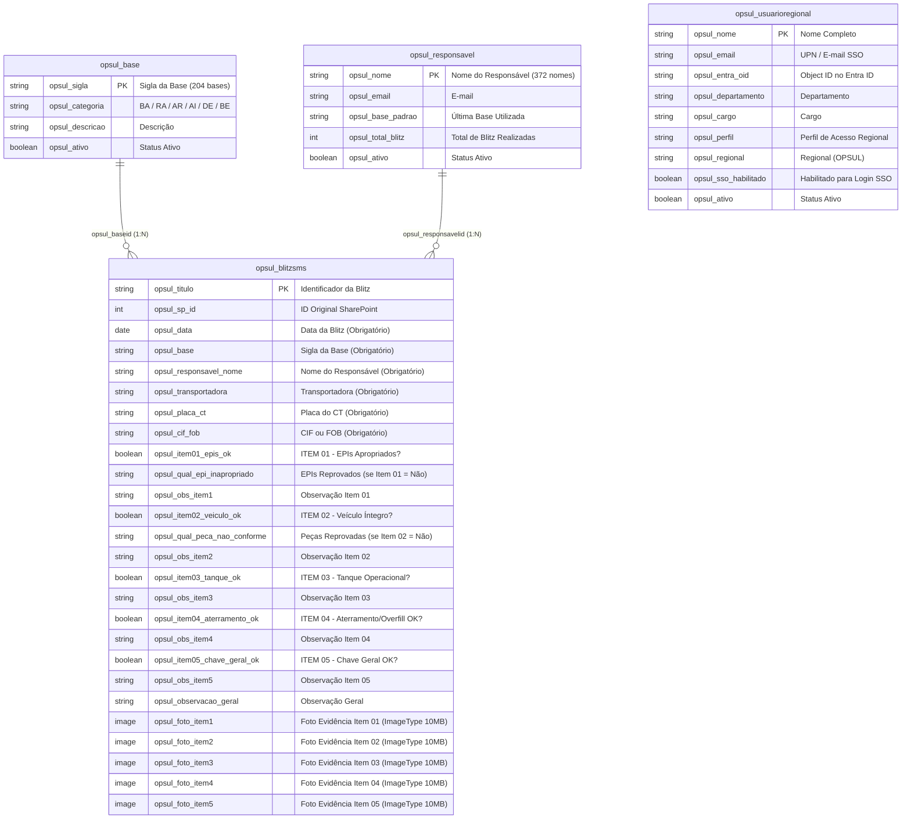

# Documentação Técnica: Arquitetura e Modelo Relacional — `OPER_OPSUL`

**Solução Dataverse:** `OPER_OPSUL` (`e11a7dcc-45d9-f111-84e8-e4fade0322c2`)  
**Publisher:** `OPER_OPSUL Vibra Energia` (`oper_opsul_publisher`, prefixo `opsul_`)  
**Ambiente Power Platform:** `Cristian Ferreira Carlos` (`4a9ba077-4920-ea16-ae45-293f56eb85e3`)  
**Organização Dataverse:** `https://orgd15f46d4.crm2.dynamics.com`  
**Versão:** `v1.0.0` (`2026-11-05`)

---

## 1. Diagrama Entidade-Relacionamento (DER — Solução `OPER_OPSUL`)

---

## 2. Especificação das 4 Tabelas Relacionais

### 2.1. `opsul_usuarioregional` (`opsul_usuarioregionals`) — Governança Regional SSO
Tabela criada para armazenar os usuários da Regional OPSUL que farão login via SSO corporativo em solução dedicada de gestão:

| Nome Completo (`opsul_nome`) | E-mail (`opsul_email`) | Entra Object ID (`opsul_entra_oid`) | Departamento (`opsul_departamento`) | Perfil (`opsul_perfil`) | SSO (`opsul_sso_habilitado`) |
| :--- | :--- | :--- | :--- | :--- | :---: |
| **Wedson Pereira da Silva** | `wedson@vibraenergia.com.br` | `19f80cc5-873f-4aa3-afea-46e92de2bfa2` | Operação Regional Sul e Sudeste | Gestor Regional OPSUL | `true` |
| **Ana Claudia Camargos Sales** | `anasales@vibraenergia.com.br` | `a57b45d7-0126-4f0a-8c45-f3a65e7161d7` | Operação Regional Sul e Sudeste | Gestora Regional OPSUL | `true` |

### 2.2. `opsul_base` (`opsul_bases`) — Catálogo de Bases Operacionais (204 siglas)
Contém todas as siglas operacionais deduplicadas (`AIBET`, `AIÇAI`, `AICAMP`, `BACUB`, `BAERI`, `BAVAP`, `RACWB`, `GEI - Gerência Industrial`, `SEDE`, etc.) classificadas automaticamente por tipo operacional.

### 2.3. `opsul_responsavel` (`opsul_responsavels`) — Catálogo de Responsáveis pela Blitz (372 registros)
Implementa a regra **"escreve o nome uma vez, depois escolhe na lista"**:
- Todos os 372 nomes históricos foram higienizados e carregados.
- Quando um inspetor acessa o formulário pela primeira vez e digita seu nome, o aplicativo adiciona o nome imediatamente à lista suspensa e o persiste para as próximas inspeções, além de pré-selecionar a base padrão do usuário.

### 2.4. `opsul_blitzsms` (`opsul_blitzsmses`) — Tabela Fato de Inspeções Blitz de SMS (3.761 registros)
Mapeia integralmente todas as colunas e dados históricos da lista SharePoint `Blitz de SMS` (`4d397d74-e478-446a-a6ba-69e9d4bcf094`), preservando o `ID` original em `opsul_sp_id` e vinculando os lookups relacionais `opsul_baseid` e `opsul_responsavelid`.

---

## 3. Identidade Visual Oficial Vibra Energia (Design System)

O formulário [`webresources/opsul_blitz_sms_app.html`](../webresources/opsul_blitz_sms_app.html) implementa fielmente os tokens visuais especificados:

| Token | HEX | Origem | Aplicação no Formulário |
| :--- | :---: | :---: | :--- |
| **VD verde escuro** | `#004415` | Oficial | Cor dominante (~60%): cabeçalho institucional, faixas de seção, ícones principais |
| **VG verde** | `#268200` | Oficial | Rótulos de seção, barras laterais dos cards (`border-left: 6px`), estados conformes |
| **VY amarelo** | `#FEDC00` | Oficial | Destaques: selos `ITEM 01` a `ITEM 05`, numeração de etapas, barra de decisão |
| **VB azul** | `#0000FF` | Oficial | Botão de ação digital (`Registrar Blitz de SMS`) e rodapé de submissão |
| **W branco** | `#FFFFFF` | Oficial | Superfície principal dos cards e textos sobre fundo verde escuro |
| **INK** | `#0B2A14` | Auxiliar | Texto principal escuro |
| **MUT** | `#55665A` | Auxiliar | Subtítulos, dicas de preenchimento e metadados |
| **SOFT** | `#F2F7EE` | Auxiliar | Fundo dos cards de itens de inspeção e barras de filtro |
| **LINE** | `#DCE7D5` | Auxiliar | Bordas estruturais dos cards e inputs |
| **BG** | `#FAFCF8` | Auxiliar | Fundo geral da página |
| **DARK2** | `#0B3218` | Auxiliar | Faixa superior de autoria e caixas de KPIs no cabeçalho |
| **CRIT** | `#D92D20` | Risco | Gravidade crítica: itens reprovados, chips de EPIs/peças não conformes e bloqueio |
| **ALTO** | `#F07B00` | Risco | Gravidade alta |
| **MED** | `#E8B400` | Risco | Gravidade média |
