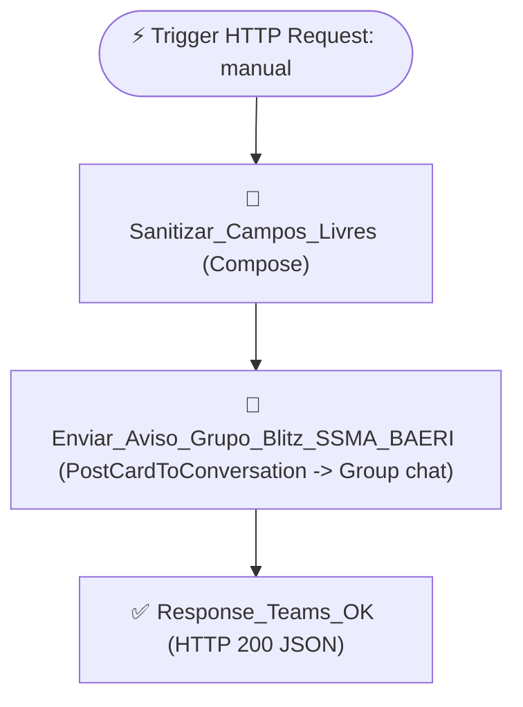

# ⚙️ Fluxo: `OPER_OPSUL - Alerta de Desvio Blitz de SMS no Teams (BAERI)`

- **Workflow ID (Dataverse):** `d5c4bed7-10da-f111-84e8-000d3a8cdf8c`
- **ProcessSimple Flow ID:** `1ab121cb-fbc1-b251-5c32-f820df970d86`
- **Ambiente Power Platform:** `autoBR@x - Desenvolvimento` (`898c553e-12ff-e6c6-8b11-bc7586165a03`)
- **Estado:** `Ativo (Started)` (`statecode: 1, statuscode: 2`)
- **Conexão Microsoft Teams:** `shared-teams-cf39a891-ddf6-442d-b7b2-00885b7377c5` (`new_sharedteams_c3243`)
- **Grupo do Teams Alvo (`BAERI`):** **`Blitz SSMA BAERI`** (`19:063ca6b11e714dc8b17d26e11c0ebd40@thread.v2`)

## Descrição
Fluxo acionado automaticamente pelo `OPER_OPSUL - API Blitz de SMS` (`592191f7-47d9-f111-84e8-e4fade0322c2`) sempre que uma inspeção Blitz de SMS em uma base com `opsul_alerta_teams_ativo = true` (iniciando por **`BAERI`**) possuir **1 ou mais desvios (não conformidades)** apontados no checklist (Itens 01 a 05).

Envia um **aviso informativo em formato Adaptive Card v1.4 (sem botões de ação)** diretamente no chat em grupo **`Blitz SSMA BAERI`** (`location: "Group chat"`, `poster: "Flow bot"`), detalhando protocolo, data, base, placa CT/frete, transportadora, responsável pela Blitz, sessão SSO do tablet, quantidade de itens com desvio, fotos anexadas e resumo de todos os desvios apontados.

## Fluxograma WDL

## Arquivos neste Diretório
- [`definition.wdl.json`](./definition.wdl.json) — Definição lógica WDL (`triggers` + `actions`)
- [`connection_references.json`](./connection_references.json) — Referências de conexão (`shared_teams`)
- [`flow_full.json`](./flow_full.json) — Snapshot completo da entidade `workflow` no Dataverse
