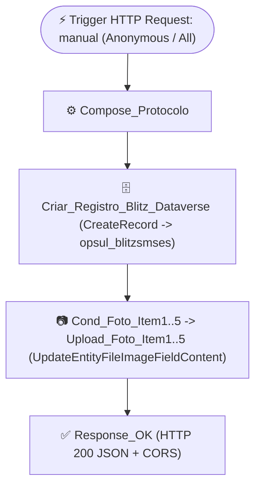

# ⚙️ Fluxo: `OPER_OPSUL - API Blitz de SMS (Sem Login)`

- **Workflow ID (Dataverse):** `592191f7-47d9-f111-84e8-e4fade0322c2`
- **Solução:** `OPER_OPSUL` (`e11a7dcc-45d9-f111-84e8-e4fade0322c2`)
- **Ambiente:** `Cristian Ferreira Carlos` (`4a9ba077-4920-ea16-ae45-293f56eb85e3`)
- **Estado:** `Ativo (Started)` (`statecode: 1, statuscode: 2`)
- **Autenticação do Trigger:** `All` (**Acesso Anônimo / Sem Login**)

## Descrição
Fluxo HTTP POST anônimo (`triggerAuthenticationType=All`) que recebe as submissões do formulário Blitz de SMS, cria o registro na tabela `opsul_blitzsms` (`CreateRecord`) e grava as fotos opcionais de não conformidade (`opsul_foto_item1` a `opsul_foto_item5`) como binário nativo no Dataverse (`UpdateEntityFileImageFieldContent`), retornando o protocolo único e o `blitz_id` via JSON com suporte a CORS.

## Fluxograma WDL

## Arquivos neste Diretório
- [`definition.wdl.json`](./definition.wdl.json) — Definição lógica WDL (`triggers` + `actions`)
- [`connection_references.json`](./connection_references.json) — Referências de conexão
- [`flow_full.json`](./flow_full.json) — Snapshot completo da entidade `workflow` no Dataverse
