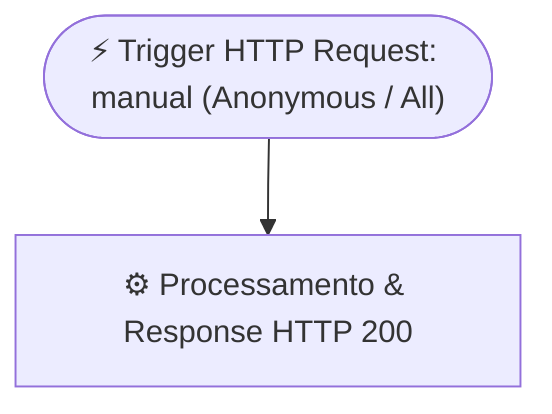

# ⚙️ Fluxo: `OPER_OPSUL - Portal Web Blitz de SMS (Redirecionador SSO Vibra)`

- **Workflow ID (Dataverse):** `8bfaac34-48d9-f111-84e8-e4fade0322c2`
- **Solução:** `OPER_OPSUL` (`e11a7dcc-45d9-f111-84e8-e4fade0322c2`)
- **Ambiente:** `Cristian Ferreira Carlos` (`4a9ba077-4920-ea16-ae45-293f56eb85e3`)
- **Estado:** `Ativo (Started)` (`statecode: 1, statuscode: 2`)
- **Destino SSO:** `https://orgd15f46d4.crm2.dynamics.com/WebResources/opsul_blitz_sms_app.html`

## Descrição
Fluxo HTTP GET que intercepta acessos ao link antigo do Portal e redireciona automaticamente (`window.location.replace` + `meta http-equiv="refresh"`) para o Web Resource autenticado no Microsoft Dataverse (`https://orgd15f46d4.crm2.dynamics.com/WebResources/opsul_blitz_sms_app.html`), exigindo login corporativo no ambiente Vibra Energia (Microsoft Entra ID SSO).

## Fluxograma WDL

## Arquivos neste Diretório
- [`definition.wdl.json`](./definition.wdl.json) — Definição lógica WDL (`triggers` + `actions`)
- [`connection_references.json`](./connection_references.json) — Referências de conexão
- [`flow_full.json`](./flow_full.json) — Snapshot completo da entidade `workflow` no Dataverse
